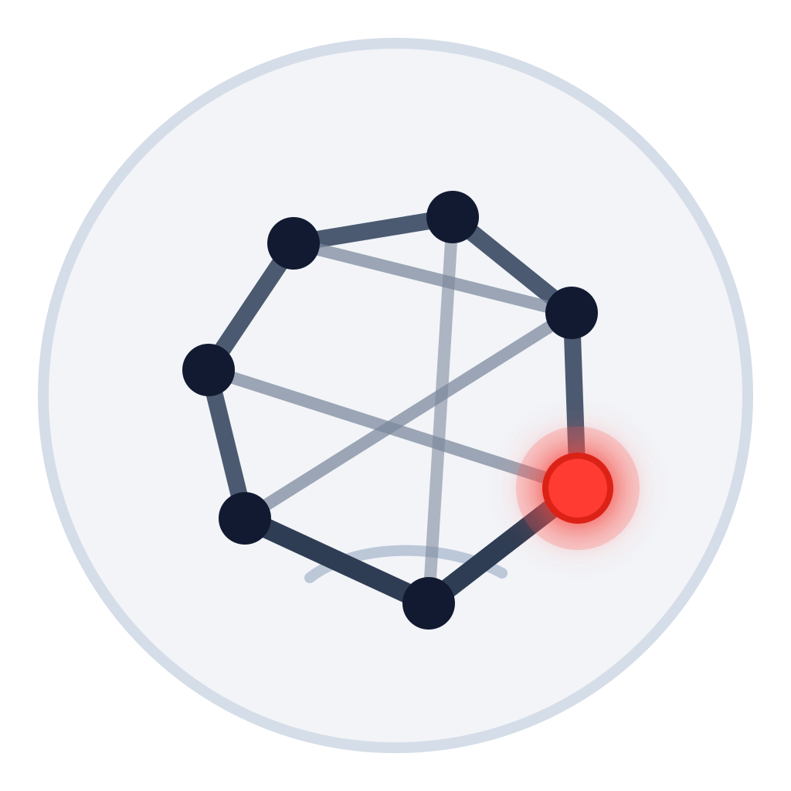

# Concept Synth

Public benchmarks for concept synthesis in first-order logic, with datasets,
model predictions, evaluation tools, and reproducible results.

<!-- BEGIN INDUCTION CHALLENGE LEADERBOARDS -->
## INDUCTION Challenge100

[**Challenge100 v2 dataset (YAML, gzip)**](benchmarks/induction/data/challenge_holdouts_v2/induction_fullobs_challenge100_v2.yaml.gz)
· [**Leaderboards**](benchmarks/induction/docs/leaderboard.md)
· [Benchmark details](benchmarks/induction/docs/challenge100_round1_provenance.md)

Challenge100 is the maintained 100-task benchmark, combining the frozen
Challenge64 set with 36 additional challenging problems. The leaderboards report
Challenge100 results and the Challenge64 projection.

[**Holdout-complete v2 datasets**](benchmarks/induction/docs/challenge_holdouts_v2.md)
provide five holdout worlds per problem. Leaderboards now use v2; for previously
released configurations, only the 14 changed tasks were re-evaluated, with
unchanged solver inputs and responses. The final
[Inception Mercury 3 results](benchmarks/induction/docs/mercury3_results.md)
use holdouts v2 from the start and include the documented non-evaluable-only retry sequence.
The [Kimi K3.1 Pro results](benchmarks/induction/docs/kimi_k31_pro_results.md)
also use v2 from the start: MAX reasoning, a 500,000-token completion cap including
thinking, and transport-only retries. Its final result is 34 training-correct and
21 holdout-correct out of 100, with 99 evaluable answers.
The [Claude Haiku 5.5 results](benchmarks/induction/docs/haiku55_results.md)
use adaptive thinking with a 128,000-token inclusive cap and bounded,
non-evaluable-only lower-effort retries: 16 training-correct and 15 holdout-correct
out of 100, with 99 strictly evaluable answers.
The [GPT-6.1 Terra results](benchmarks/induction/docs/terra61_results.md)
use Flex, MAX reasoning and a 128,000-token inclusive output cap, with rolling
non-evaluable-only XHIGH retries: 67 training-correct and 33 holdout-correct
out of 100, with 100 evaluable answers (99 strict).
<!-- END INDUCTION CHALLENGE LEADERBOARDS -->

Explore the full releases: [ABD](benchmarks/abduction/) · [INDUCTION](benchmarks/induction/).



## ABD

[Paper](https://arxiv.org/abs/2602.18843) · [Paper summary](https://gist.science/paper/2602.18843)

The ABD release ships canonical benchmark instances, matched holdout worlds,
released model predictions, a frozen evaluation cache, prompt examples, and a
runnable `concept_synth.abduction` package with the prompt builder, evaluator
CLI, checker, and parser support.

## INDUCTION

Paper: *INDUCTION: Finite-Structure Concept Synthesis in First-Order Logic*
(ICML 2026, spotlight)

The INDUCTION release ships canonical FullObs, CI, and EC benchmark instances,
released model prediction records, a frozen evaluation cache, prompt examples,
and a runnable `concept_synth.induction` package with prompt rendering, exact
finite-world evaluation, and deterministic generation of new schema-compatible
benchmark instances. It intentionally does not include model-running clients;
users should call models through their own infrastructure and evaluate the
resulting prediction JSONL files with the public CLI.

The core INDUCTION v1.0 artifacts contain 775 benchmark instances and 11,413
released prediction/eval rows across 15 model identifiers, including Gemini
3.5 Flash.

See the [INDUCTION release documentation](benchmarks/induction/) for datasets,
normalized predictions, and frozen train and generated-holdout evaluation caches.

## Getting started

Task-family-specific code lives in subpackages such as
`concept_synth.abduction` and `concept_synth.induction`.

Install from the repository root:

```bash
python3 -m venv .venv
source .venv/bin/activate
pip install -e ".[dev]"
```

Then, for example:

```bash
concept-synth-abd-build-prompt --instance-id ABD_FULL_TH10_000
./benchmarks/abduction/scripts/rebuild_eval_cache.sh --limit 5
./benchmarks/abduction/scripts/reproduce_tables.sh

concept-synth-induction-build-prompt \
  --dataset benchmarks/induction/data/induction_fullobs_v1.yaml.gz \
  --instance-id simple_001
concept-synth-induction-generate \
  --task all \
  --n 5 \
  --seed 20260516 \
  --validate \
  --output benchmarks/induction/generated_instances/induction_generated_sample.yaml
./benchmarks/induction/scripts/rebuild_eval_cache.sh --limit 5 --no-diagnostics
./benchmarks/induction/scripts/reproduce_tables.sh

pytest -q
```

## License and contact

All benchmark data, prompts, cached outputs, scripts, and code in this
repository are released under the [MIT License](LICENSE) unless noted otherwise.

Contact: [serafim.batzoglou@gmail.com](mailto:serafim.batzoglou@gmail.com)
