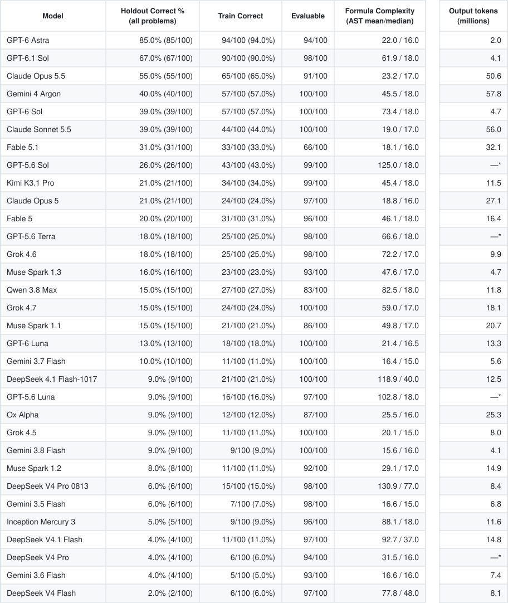

# INDUCTION Challenge Leaderboards

**Holdouts v2:** five worlds per task; only the 14 changed tasks re-evaluated. [Version details](challenge_holdouts_v2.md) · [v1 results](leaderboard_holdout_v1.md).

Inception Mercury 3 used holdouts v2 from the start and includes authorized non-evaluable-only retries and residual passes. [Protocol and accounting](mercury3_results.md).

Challenge100 is the ordered union of the frozen Challenge64 benchmark and the disjoint New36 component. All 31 Challenge100 models appear in the Challenge64 table, alongside 19 additional models with Challenge64 results. Each table is ranked independently by Holdout Correct % over all problems in its task set, so model order differs.

Missing, provider-error, empty, output-limit-incomplete, and parse-invalid responses count as incorrect. A multi-formula response is evaluable if any submitted formula parses and correct if any submitted formula is train-valid. Residual cascades use parser-evaluable priority only, never correctness or holdout outcomes.

Holdout Correct % is the number of train-correct formulas verified correct on all five holdout worlds, divided by all 100 or 64 problems. All tasks now have holdouts; unscored responses remain unknown, not measured holdout failures, and receive no verified credit. Response selection, training scores, formula complexity and token usage are unchanged.

## Challenge100

Rows are ranked by Holdout Correct % (out of 100), then Train Correct, Evaluable coverage, and model name.

\* Challenge64 usage missing.

Output tokens include reasoning once and all known attempts, including non-evaluable responses. Unreported usage is excluded; these figures are lower bounds where usage is missing. [Token data](../eval/challenge100_output_token_usage_v2.json).

Text-only leaderboard and token usage

| Model | Holdout Correct % (all problems) | Train Correct | Evaluable | Formula Complexity (AST mean/median) | Output tokens (M) |
|---|---:|---:|---:|---:|---:|
| GPT-6 Astra | 85.0% (85/100) | 94/100 (94.0%) | 94/100 | 22.0 / 16.0 | 2.0 |
| GPT-6.1 Sol | 67.0% (67/100) | 90/100 (90.0%) | 98/100 | 61.9 / 18.0 | 4.1 |
| Claude Opus 5.5 | 55.0% (55/100) | 65/100 (65.0%) | 91/100 | 23.2 / 17.0 | 50.6 |
| Gemini 4 Argon | 40.0% (40/100) | 57/100 (57.0%) | 100/100 | 45.5 / 18.0 | 57.8 |
| GPT-6 Sol | 39.0% (39/100) | 57/100 (57.0%) | 100/100 | 73.4 / 18.0 | 4.7 |
| Claude Sonnet 5.5 | 39.0% (39/100) | 44/100 (44.0%) | 100/100 | 19.0 / 17.0 | 56.0 |
| Fable 5.1 | 31.0% (31/100) | 33/100 (33.0%) | 66/100 | 18.1 / 16.0 | 32.1 |
| GPT-5.6 Sol | 26.0% (26/100) | 43/100 (43.0%) | 99/100 | 125.0 / 18.0 | —* |
| Claude Opus 5 | 21.0% (21/100) | 24/100 (24.0%) | 97/100 | 18.8 / 16.0 | 27.1 |
| Fable 5 | 20.0% (20/100) | 31/100 (31.0%) | 96/100 | 46.1 / 18.0 | 16.4 |
| GPT-5.6 Terra | 18.0% (18/100) | 25/100 (25.0%) | 98/100 | 66.6 / 18.0 | —* |
| Grok 4.6 | 18.0% (18/100) | 25/100 (25.0%) | 98/100 | 72.2 / 17.0 | 9.9 |
| Muse Spark 1.3 | 16.0% (16/100) | 23/100 (23.0%) | 93/100 | 47.6 / 17.0 | 4.7 |
| Qwen 3.8 Max | 15.0% (15/100) | 27/100 (27.0%) | 83/100 | 82.5 / 18.0 | 11.8 |
| Grok 4.7 | 15.0% (15/100) | 24/100 (24.0%) | 100/100 | 59.0 / 17.0 | 18.1 |
| Muse Spark 1.1 | 15.0% (15/100) | 21/100 (21.0%) | 86/100 | 49.8 / 17.0 | 20.7 |
| GPT-6 Luna | 13.0% (13/100) | 18/100 (18.0%) | 100/100 | 21.4 / 16.5 | 13.3 |
| Gemini 3.7 Flash | 10.0% (10/100) | 11/100 (11.0%) | 100/100 | 16.4 / 15.0 | 5.6 |
| DeepSeek 4.1 Flash-1017 | 9.0% (9/100) | 21/100 (21.0%) | 100/100 | 118.9 / 40.0 | 12.5 |
| GPT-5.6 Luna | 9.0% (9/100) | 16/100 (16.0%) | 97/100 | 102.8 / 18.0 | —* |
| Ox Alpha | 9.0% (9/100) | 12/100 (12.0%) | 87/100 | 25.5 / 16.0 | 25.3 |
| Grok 4.5 | 9.0% (9/100) | 11/100 (11.0%) | 100/100 | 20.1 / 15.0 | 8.0 |
| Gemini 3.8 Flash | 9.0% (9/100) | 9/100 (9.0%) | 100/100 | 15.6 / 16.0 | 4.1 |
| Muse Spark 1.2 | 8.0% (8/100) | 11/100 (11.0%) | 92/100 | 29.1 / 17.0 | 14.9 |
| DeepSeek V4 Pro 0813 | 6.0% (6/100) | 15/100 (15.0%) | 98/100 | 130.9 / 77.0 | 8.4 |
| Gemini 3.5 Flash | 6.0% (6/100) | 7/100 (7.0%) | 98/100 | 16.6 / 15.0 | 6.8 |
| Inception Mercury 3 | 5.0% (5/100) | 9/100 (9.0%) | 96/100 | 88.1 / 18.0 | 11.6 |
| DeepSeek V4.1 Flash | 4.0% (4/100) | 11/100 (11.0%) | 97/100 | 92.7 / 37.0 | 14.8 |
| DeepSeek V4 Pro | 4.0% (4/100) | 6/100 (6.0%) | 94/100 | 31.5 / 16.0 | —* |
| Gemini 3.6 Flash | 4.0% (4/100) | 5/100 (5.0%) | 93/100 | 16.6 / 16.0 | 7.4 |
| DeepSeek V4 Flash | 2.0% (2/100) | 6/100 (6.0%) | 97/100 | 77.8 / 48.0 | 8.1 |

Challenge100 formula complexity covers all train-correct direct formulas across its 100 tasks. Holdout Correct % combines verified successes from the frozen Challenge64 and New36 sidecars, divided by all 100 problems.

## Challenge64 projection

Rows are ranked by Holdout Correct % (out of 64), then Train Correct, Evaluable coverage, and model name. Holdout is a post-selection diagnostic and is never used for prompting or selection.

| Model | Holdout Correct % (all problems) | Train Correct | Evaluable | Formula Complexity (AST mean/median) |
|---|---:|---:|---:|---:|
| GPT-6 Astra | 87.5% (56/64) | 63/64 (98.4%) | 63/64 | 20.6 / 18.0 |
| GPT-6.1 Sol | 67.2% (43/64) | 61/64 (95.3%) | 63/64 | 45.7 / 18.0 |
| Claude Opus 5.5 | 56.2% (36/64) | 46/64 (71.9%) | 59/64 | 26.0 / 18.0 |
| Claude Sonnet 5.5 | 42.2% (27/64) | 32/64 (50.0%) | 64/64 | 19.6 / 18.0 |
| GPT-6 Sol | 39.1% (25/64) | 42/64 (65.6%) | 64/64 | 93.0 / 18.0 |
| Gemini 4 Argon | 39.1% (25/64) | 42/64 (65.6%) | 64/64 | 55.9 / 18.0 |
| GPT-5.6 Sol | 31.2% (20/64) | 37/64 (57.8%) | 63/64 | 143.0 / 18.0 |
| Fable 5.1 | 31.2% (20/64) | 22/64 (34.4%) | 47/64 | 17.6 / 16.0 |
| Claude Opus 5 | 28.1% (18/64) | 21/64 (32.8%) | 62/64 | 19.2 / 16.0 |
| GPT-5.6 Terra | 26.6% (17/64) | 24/64 (37.5%) | 62/64 | 68.8 / 18.0 |
| Fable 5 | 25.0% (16/64) | 27/64 (42.2%) | 63/64 | 50.3 / 18.0 |
| Grok 4.6 | 25.0% (16/64) | 23/64 (35.9%) | 62/64 | 76.9 / 17.0 |
| Muse Spark 1.3 | 25.0% (16/64) | 23/64 (35.9%) | 59/64 | 47.6 / 17.0 |
| Qwen 3.8 Max | 23.4% (15/64) | 27/64 (42.2%) | 63/64 | 82.5 / 18.0 |
| Muse Spark 1.1 | 23.4% (15/64) | 21/64 (32.8%) | 56/64 | 49.8 / 17.0 |
| Grok 4.7 | 20.3% (13/64) | 22/64 (34.4%) | 64/64 | 62.9 / 17.5 |
| GPT-6 Luna | 20.3% (13/64) | 18/64 (28.1%) | 64/64 | 21.4 / 16.5 |
| Grok 4 | 18.8% (12/64) | 13/64 (20.3%) | 59/64 | 17.7 / 16.0 |
| GPT-5.4 | 15.6% (10/64) | 12/64 (18.8%) | 64/64 | 22.8 / 16.0 |
| Gemini 3.7 Flash | 15.6% (10/64) | 11/64 (17.2%) | 64/64 | 16.4 / 15.0 |
| DeepSeek 4.1 Flash-1017 | 14.1% (9/64) | 21/64 (32.8%) | 64/64 | 118.9 / 40.0 |
| Ox Alpha | 14.1% (9/64) | 12/64 (18.8%) | 54/64 | 25.5 / 16.0 |
| Grok 4.5 | 14.1% (9/64) | 11/64 (17.2%) | 64/64 | 20.1 / 15.0 |
| Gemini 3.8 Flash | 14.1% (9/64) | 9/64 (14.1%) | 64/64 | 15.6 / 16.0 |
| GPT-5.6 Luna | 12.5% (8/64) | 15/64 (23.4%) | 61/64 | 108.9 / 18.0 |
| Muse Spark 1.2 | 12.5% (8/64) | 11/64 (17.2%) | 59/64 | 29.1 / 17.0 |
| DeepSeek V4 Pro 0813 | 9.4% (6/64) | 15/64 (23.4%) | 64/64 | 130.9 / 77.0 |
| Gemini 3.5 Flash | 9.4% (6/64) | 7/64 (10.9%) | 63/64 | 16.6 / 15.0 |
| Grok 4.1 Fast | 9.4% (6/64) | 6/64 (9.4%) | 64/64 | 14.8 / 14.5 |
| Inception Mercury 3 | 7.8% (5/64) | 9/64 (14.1%) | 60/64 | 88.1 / 18.0 |
| Kimi K3 | 7.8% (5/64) | 7/64 (10.9%) | 64/64 | 22.9 / 17.0 |
| Claude Opus 4.6 | 7.8% (5/64) | 5/64 (7.8%) | 64/64 | 14.8 / 15.0 |
| DeepSeek V4.1 Flash | 6.2% (4/64) | 11/64 (17.2%) | 63/64 | 92.7 / 37.0 |
| DeepSeek V4 Pro | 6.2% (4/64) | 6/64 (9.4%) | 63/64 | 31.5 / 16.0 |
| Gemini 3.6 Flash | 6.2% (4/64) | 5/64 (7.8%) | 64/64 | 16.6 / 16.0 |
| Kimi K2.7 Code | 6.2% (4/64) | 5/64 (7.8%) | 64/64 | 36.0 / 15.0 |
| Claude Opus 4.8 | 6.2% (4/64) | 4/64 (6.2%) | 64/64 | 15.2 / 15.5 |
| GPT-5.2 | 4.7% (3/64) | 9/64 (14.1%) | 64/64 | 85.1 / 95.0 |
| Kimi K2.6 | 4.7% (3/64) | 3/64 (4.7%) | 62/64 | 15.3 / 15.0 |
| Claude Sonnet 5 | 4.7% (3/64) | 3/64 (4.7%) | 47/64 | 14.3 / 14.0 |
| DeepSeek V4 Flash | 3.1% (2/64) | 6/64 (9.4%) | 62/64 | 77.8 / 48.0 |
| Grok 4.3 | 3.1% (2/64) | 2/64 (3.1%) | 63/64 | 15.5 / 15.5 |
| Gemini 3 Pro Preview | 1.6% (1/64) | 3/64 (4.7%) | 64/64 | 31.0 / 23.0 |
| Gemini 3.1 Pro | 1.6% (1/64) | 1/64 (1.6%) | 64/64 | 12.0 / 12.0 |
| DeepSeek Reasoner | 1.6% (1/64) | 1/64 (1.6%) | 63/64 | 15.0 / 15.0 |
| Claude Opus 4.5 | 0.0% (0/64) | 0/64 (0.0%) | 64/64 | N/A |
| GPT-4o | 0.0% (0/64) | 0/64 (0.0%) | 64/64 | N/A |
| Hermes 4 | 0.0% (0/64) | 0/64 (0.0%) | 64/64 | N/A |
| Qwen 3.7 Max | 0.0% (0/64) | 0/64 (0.0%) | 59/64 | N/A |
| Qwen 3.5 | 0.0% (0/64) | 0/64 (0.0%) | 43/64 | N/A |

Formula complexity reports AST mean/median over train-correct direct formulas.
